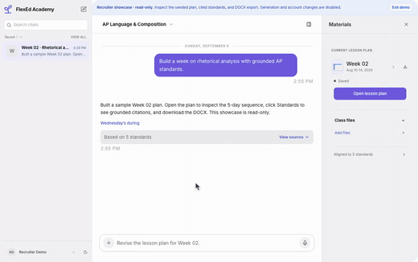
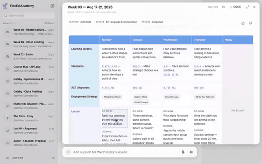

# FlexEd Academy

FlexEd helps teachers turn a weekly teaching request into a five-day lesson plan. Review the standards behind each lesson, revise one activity at a time, and export the week in your school’s Word template.

[Try the read-only demo](https://flexedacademy.com) · [Download the sample Word plan](./FlexedAcademy_Sample_Lesson_Plan.docx?raw=1) · [Read the engineering case study](./FlexedAcademy_Case_Study.md)

## Watch FlexEd in use

| Preview | Walkthrough |
| --- | --- |
|  | **[Set up a class and build a first plan](./media/onboarding.mp4)** · 0:32  Choose Alabama, 11th grade, and AP English Language. Pick a week, enter a topic on voice and tone in Poe, then open the five-day plan. |
|  | **[Check a citation and export the week](./media/review-and-export.mp4)** · 0:18  Open the saved rhetorical analysis week in the public demo. Read the source text for skill **7.A**, open the plan, and see the downloaded Word document. |
|  | **[Revise Monday’s warm-up](./media/edit-an-activity.mp4)** · 0:14  Ask partners to defend their choice of the most trustworthy speaker. Edit Monday’s activity directly in the table and save the change. |

The onboarding and editing recordings use sample data in a local preview. To follow the citation and export walkthrough yourself, choose **See a finished lesson plan** on the signed-out homepage.

I built FlexEd as a solo project, connecting planning, revision, source inspection,
and Word export in one teacher workflow.

## What I built

- **Grounded planning:** keyword and semantic search, course and grade filters, and checks that cited standards come from the retrieved sources.
- **Complete application:** Python/FastAPI, React, structured OpenAI outputs, tool-driven revision, Postgres storage, and Word export.
- **Reliability:** recoverable generation and export jobs, regression tests, token-cost estimates, and latency/failure measurements.

## Engineering decisions

**Check sources before saving.** Course and grade filters narrow retrieval;
citation checks flag codes outside the retrieved sources. This makes the source
behind a generated plan inspectable.

**Trace wrong-course results to the retrieval layer.** I traced a bug in which
retrieval returned standards for the wrong course, added course filters to the
retrieval step, and wrote regression tests so the same cross-course error is
caught by tests. Those tests sit alongside the 61/61 recall@5 retrieval
regression gate and the citation audit.

**Recover interrupted work.** Generation and document export use recoverable
jobs, so a lost connection does not have to discard completed work.

Request → retrieve standards → generate and validate → save → Word export.

## Results

| Evidence | What it establishes |
| --- | --- |
| Historical retrieval check | Expected standard found in the top five results for **61/61 corpus cases**; not rerun for this update. |
| Production snapshot | Working demo path recorded **September 6, 2026**; a dated product check, not current uptime or adoption data. |
| Offline evaluator | **22 tests passed** on **November 4, 2026**, verifying reporting behavior rather than hosted model performance. |

Next evaluation: [40 drafted teacher tasks](./evaluation/README.md) await expert
reference review. Hosted evaluation has not run; no generation-quality score is
claimed.

AP Language has the deepest evaluation coverage. Retrieval accuracy does not
establish instructional quality; teachers should review generated plans.

## Explore further

[Architecture and tradeoffs](./FlexedAcademy_Case_Study.md) · [Historical production checks](./PRODUCTION_EVIDENCE.md) · [Sample Word output](./FlexedAcademy_Sample_Lesson_Plan.docx) · [Earlier walkthrough (MP4)](./FlexedAcademy_Walkthrough.mp4)

Application source is private and is not included in this repository.

## Portfolio

Public evidence for other work is indexed separately from this FlexEd showcase. Those pages do not include application source. [Portfolio index](./portfolio/README.md)

## License

Joshua Cole's original work in this repository is proprietary. Copyright (c) 2026 Joshua Cole. All rights reserved. No permission is granted to use, copy, modify, distribute, or sublicense it without prior written permission. See [LICENSE](./LICENSE).
