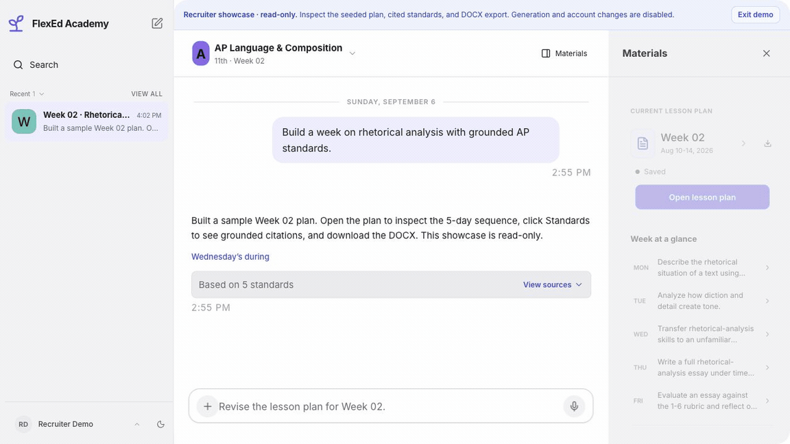

# FlexEd Academy

**FlexEd Academy helps teachers turn a weekly teaching request into a standards-grounded lesson plan and a district-style Word document.**

[Open the read-only demo](https://flexedacademy.com) · [Read the case study](./FlexedAcademy_Case_Study.md) · [Inspect engineering evidence](./ENGINEERING_EVIDENCE.md)

*Captured November 5, 2026 in the public read-only demo. On the signed-out homepage, choose **See a finished lesson plan** to inspect the same seeded plan, its sources, and Word export.*

I built FlexEd as a solo project, connecting planning, revision, source inspection,
and Word export in one teacher workflow.

## What I built

- **Grounded planning:** keyword and semantic search, course and grade filters, and checks that cited standards come from the retrieved sources.
- **Complete application:** Python/FastAPI, React, structured OpenAI outputs, tool-driven revision, Postgres storage, and Word export.
- **Reliability:** recoverable generation and export jobs, regression tests, token-cost estimates, and latency/failure measurements.

## Engineering decisions

**Check sources before saving.** Course and grade filters narrow retrieval;
citation checks flag codes outside the retrieved sources. This makes the source
behind a generated plan inspectable.

**Recover interrupted work.** Generation and document export use recoverable
jobs, so a lost connection does not have to discard completed work.

Request → retrieve standards → generate and validate → save → Word export.

## Results

| Evidence | What it establishes |
| --- | --- |
| Historical retrieval check | Expected standard found in the top five results for **61/61 corpus cases**; not rerun for this update. |
| Production snapshot | Working demo path recorded **September 6, 2026**; a dated product check, not current uptime or adoption data. |
| Offline evaluator | **22 tests passed** on **November 4, 2026**, verifying reporting behavior rather than hosted model performance. |

Next evaluation: [40 drafted teacher tasks](./evaluation/README.md) await expert
reference review. Hosted evaluation has not run; no generation-quality score is
claimed.

AP Language has the deepest evaluation coverage. Retrieval accuracy does not
establish instructional quality; teachers should review generated plans.

## Explore further

[Architecture and tradeoffs](./FlexedAcademy_Case_Study.md) · [Historical production checks](./PRODUCTION_EVIDENCE.md) · [Sample Word output](./FlexedAcademy_Sample_Lesson_Plan.docx) · [Earlier walkthrough (MP4)](./FlexedAcademy_Walkthrough.mp4)

Source code is private and available on request.

## License

Joshua Cole's original work in this repository is proprietary. Copyright (c) 2026 Joshua Cole. All rights reserved. No permission is granted to use, copy, modify, distribute, or sublicense it without prior written permission. See [LICENSE](./LICENSE).
