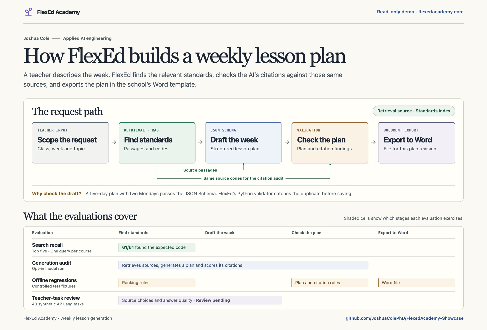

# FlexEd Academy

FlexEd helps teachers turn a weekly teaching request into a five-day lesson plan. Review the standards behind each lesson, revise one activity at a time, and export the week in your school’s Word template.

[Try the read-only demo](https://flexedacademy.com) · [Download the sample Word plan](./FlexedAcademy_Sample_Lesson_Plan.docx?raw=1) · [Read the engineering case study](./FlexedAcademy_Case_Study.md)

## Watch FlexEd in use

### Plan your first week with Sprout · 0:43

Choose a state, grade, and course, then give FlexEd a topic on suspense in Poe. Watch Sprout react as the teacher flips back to change the week, keeps the original topic, and opens the finished lesson plan.

https://github.com/user-attachments/assets/293792ba-093c-42fe-b007-3cc0bbc2a1be

[Download the MP4 with English captions](./media/onboarding.mp4?raw=1) · [See Sprout’s hand signals up close](./media/onboarding-preview.gif)

### Check a citation and export the week · 0:18

Open the saved rhetorical analysis week in the public demo. Read the source text for skill **7.A**, open the plan, and see the downloaded Word document.

https://github.com/user-attachments/assets/096696d3-e350-4d20-93dd-3c42bb8738c2

### Revise Monday’s warm-up · 0:14

Edit Monday’s activity to ask partners to defend their choice of the most trustworthy speaker, then save the change.

https://github.com/user-attachments/assets/41641fd4-245d-4760-9537-7372adfec037

The onboarding and editing recordings use sample data in a local preview. To follow the citation and export walkthrough yourself, choose **See a finished lesson plan** on the signed-out homepage.

I built FlexEd as a solo project, connecting planning, revision, source inspection,
and Word export in one teacher workflow.

## What I built

- **Grounded planning:** keyword and semantic search, course and grade filters, and checks that cited standards come from the retrieved sources.
- **Complete application:** Python/FastAPI, React, structured OpenAI outputs, tool-driven revision, Postgres storage, and Word export.
- **Reliability:** recoverable generation and export jobs, regression tests, token-cost estimates, and latency/failure measurements.

## Engineering decisions

**Check sources before saving.** Course and grade filters narrow retrieval;
citation checks flag codes outside the retrieved sources. This makes the source
behind a generated plan inspectable.

**Recover interrupted work.** Generation and document export use recoverable
jobs, so a lost connection does not have to discard completed work.

## How it works

## Results

| Evidence | What it establishes |
| --- | --- |
| Historical retrieval check | Expected standard found in the top five results for **61/61 corpus cases**; not rerun for this update. |
| Production snapshot | Working demo path recorded **September 6, 2026**; a dated product check, not current uptime or adoption data. |
| Offline evaluator | **22 tests passed** on **November 4, 2026**, verifying reporting behavior rather than hosted model performance. |

Next evaluation: [40 drafted teacher tasks](./evaluation/README.md) await expert
reference review. Hosted evaluation has not run; no generation-quality score is
claimed.

AP Language has the deepest evaluation coverage. Retrieval accuracy does not
establish instructional quality; teachers should review generated plans.

## Explore further

[Architecture and tradeoffs](./FlexedAcademy_Case_Study.md) · [Historical production checks](./PRODUCTION_EVIDENCE.md) · [Sample Word output](./FlexedAcademy_Sample_Lesson_Plan.docx) · [Download the earlier walkthrough (MP4)](./FlexedAcademy_Walkthrough.mp4?raw=1)

Application source is private and is not included in this repository.

## Portfolio

Public evidence for other work is indexed separately from this FlexEd showcase. Those pages do not include application source. [Portfolio index](./portfolio/README.md)

## License

Joshua Cole's original work in this repository is proprietary. Copyright (c) 2026 Joshua Cole. All rights reserved. No permission is granted to use, copy, modify, distribute, or sublicense it without prior written permission. See [LICENSE](./LICENSE).
