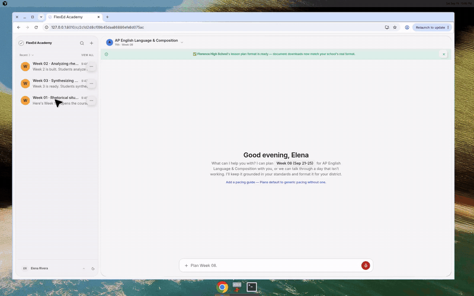

# FlexEd Academy

**FlexEd Academy helps teachers turn a weekly teaching request into a standards-grounded lesson plan and a district-style Word document.**

[Explore the demo](https://flexedacademy.com) · [Read the case study](./FlexedAcademy_Case_Study.md) · [Inspect engineering evidence](./ENGINEERING_EVIDENCE.md)

On the sign-in page, choose **Explore demo**. Browse sample plans, citations,
and Word export without signing up or adding a payment method. The demo is read-only;
generation and edits are disabled. The recorded walkthrough above is also
available if the hosted demo is unavailable.

I built and operate FlexEd as a solo project for teachers who need usable plans
with checkable standards. It connects source retrieval, generation, revision,
and Word export in one workflow, so teachers can inspect a plan before using it.

## What I built

- **Grounded planning:** keyword and semantic search, course and grade filters, and checks that cited standards come from the retrieved sources.
- **Complete application:** Python/FastAPI, React, structured OpenAI outputs, tool-driven revision, Postgres storage, and Word export.
- **Reliability:** recoverable generation and export jobs, regression tests, token-cost estimates, and latency/failure measurements.

## Results

| Evidence | What it establishes |
| --- | --- |
| Historical retrieval check | Expected standard found in the top five results for **61/61 corpus cases**; not rerun for this update. |
| Production snapshot | Working demo path recorded **September 6, 2026**; a dated product check, not current uptime or adoption data. |
| Offline evaluator | **22 tests passed** on **November 4, 2026**, verifying reporting behavior rather than hosted model performance. |

Next evaluation: [40 drafted teacher tasks](./evaluation/README.md) await expert
reference review. Hosted evaluation has not run; no generation-quality score is
claimed.

AP Language has the deepest evaluation coverage. Retrieval accuracy does not
establish instructional quality; teachers should review generated plans.

## How it works

Teacher request → find relevant standards → generate and check a plan → save → Word export.

The interface streams progress while the backend validates the completed plan
before saving it. Document export runs as a recoverable job, so a disconnected
browser or interrupted export does not have to mean starting over.

## Explore further

[Architecture and tradeoffs](./FlexedAcademy_Case_Study.md) · [Historical production checks](./PRODUCTION_EVIDENCE.md) · [Sample Word output](./FlexedAcademy_Sample_Lesson_Plan.docx) · [Full-quality walkthrough](./FlexedAcademy_Walkthrough.mp4)

Source code is private and available on request.
