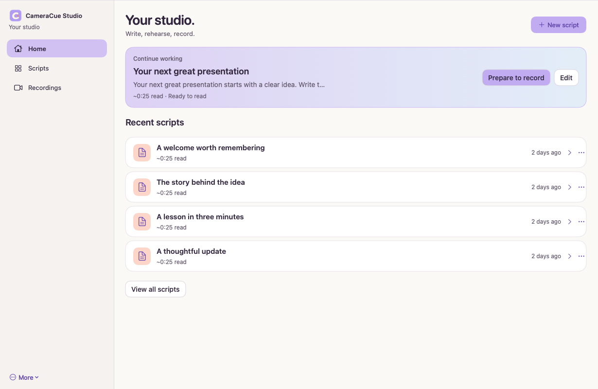
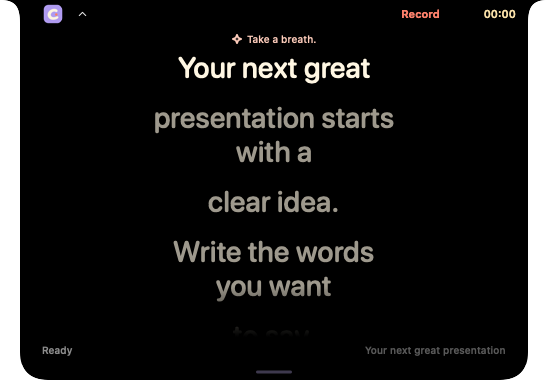
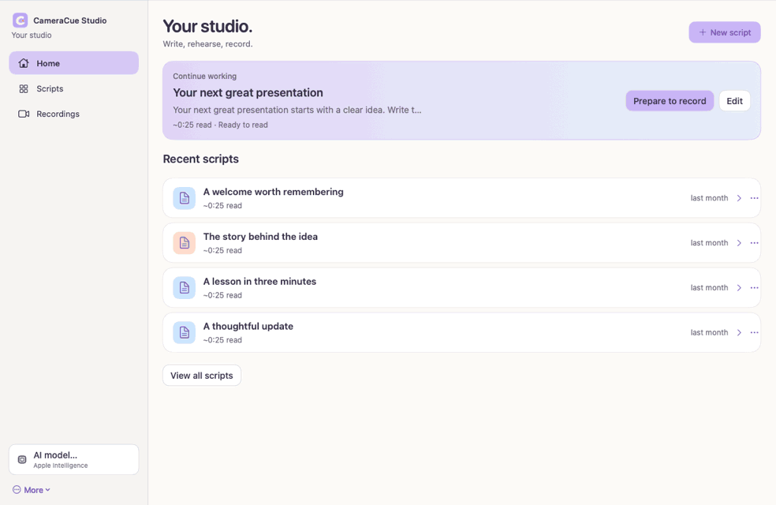
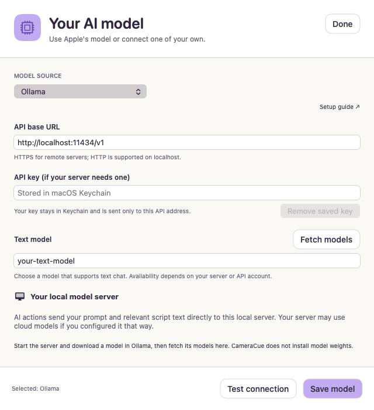

# CameraCue

CameraCue is a native Mac teleprompter. The presenter writes a script, rehearses it, records, and reviews the take while speech tracking holds a place in the script. Public evidence is this page. The application repository is private, and its source is not included here.

*Studio home with sample scripts. This is a product screen, not a measurement.*

*Compact reader with a sample script.*

*Silent Studio walkthrough. The speech in the recording is simulated. It does not measure recognition accuracy.*

*Optional model settings. The screen shows a local server example and a Keychain placeholder. It does not show a provider key. Optional drafting can use Apple's on-device model or a model the user configures. CameraCue has no required backend.*

## What was measured

The alignment result is a replay of published speeches with deterministic simulated recognizer callbacks. It is not live microphone accuracy, not a word-error rate from a room, and not microphone-to-screen latency.

The frozen held-out file at application revision `2722ec25febc97cefb7ed7115d4a0cd9024e65d5` contains 48 cases and **6,408** scored callbacks for the current tracker. **99.44%** of those callbacks were within two normalized script tokens. The previous tracker, on the same callbacks, was within two tokens **92.63%** of the time. An exact three-word suffix baseline was within two tokens **89.25%** of the time. The current tracker had 0 wrong moves and 0 wrong jumps on that split. The published comparison also records recovery from scripted skips and restarts: **12/12** for the current tracker and **6/12** for the previous tracker.

A separate recorded-audio pilot used one held-out speaker at 1× playback. Fast reporting stayed within two tokens **58.9%** of the time, against **57.1%** for the exact-match baseline. Standard reporting was **17.3%**. That pilot is real recognizer output, not the 99.44% replay, and it does not measure physical display latency.

| Result | Scope | Do not read it as |
| --- | --- | --- |
| 99.44% within two tokens | 6,408 simulated held-out callbacks | Live recognition accuracy |
| 12/12 recovered | Scripted skips and restarts in that replay | Performance in a room |
| 58.9% within two tokens | One-speaker recorded-audio pilot, fast reporting | The same quantity as the replay |

## How it is built

Swift, SwiftUI, AppKit, Apple Speech, and AVFoundation. Capture and alignment stay on the Mac. The aligner compares recent normalized tokens with the script and holds the last reliable position when the transcript is weak, duplicate, or revised. Optional text help is user-configured. A scan of revision `2722ec2` found no embedded owner provider key and no owner-paid proxy. Scroll "proxy" names in the interface code are view helpers, not a network proxy.

## What is not claimed

Physical microphone-to-highlight latency, performance across speakers and rooms, notarized distribution, and a general accuracy rate are not established. The optional learned confidence check is experimental and off by default.

## License

This page is evidence in this repository, not a copy of the application. Copyright (c) 2026 Joshua Cole. All rights reserved. See [LICENSE](../../LICENSE).
