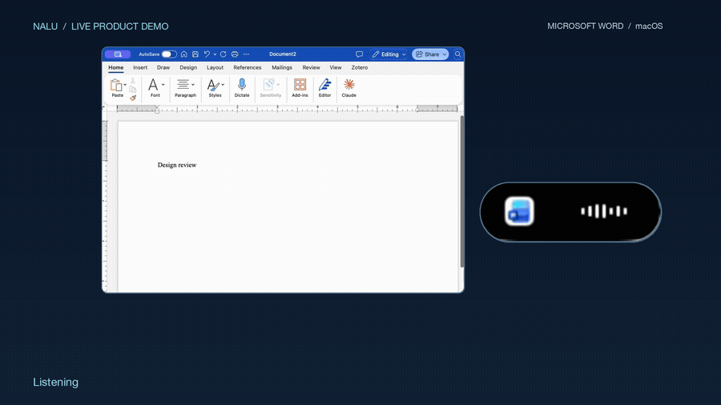
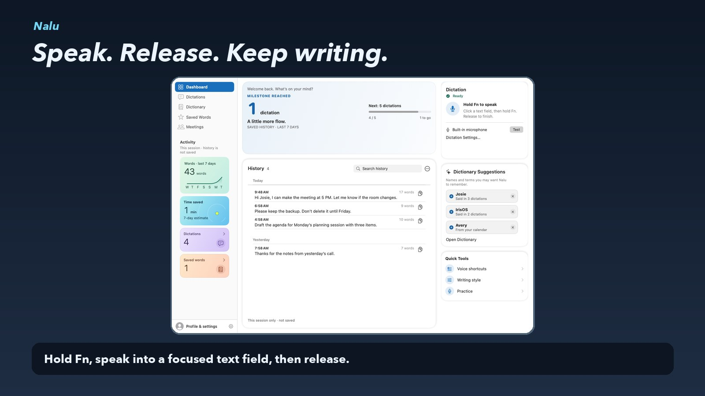

# Nalu

Nalu is a Mac dictation app. Hold Function in a text field, speak, and release. Apple Speech transcribes on the Mac. An optional cleanup pass can send that text to a hosted service, check protected wording, and insert the result. Public evidence is this page. The application source is private and is not included here.

*Recorded demonstration in Microsoft Word. The recording shows the interaction. It is not a latency trial and it is not an accuracy score.*

*Sample product screen. The history lines and dictionary names are demo content, not a customer record. The screen says the session history is not saved.*

## What was measured

The timing result is a paired HTTP benchmark of the cleanup request, recorded October 28, 2026. Two rounds used the same nine synthetic inputs for a baseline request and a Fast-tier request: **36** requests in total. Every request passed its original quality check, **18/18** on each arm.

| Arm | Requests | Median HTTP time | p95 HTTP time |
| --- | ---: | ---: | ---: |
| Baseline | 18 | 1,135.5 ms | 2,131 ms |
| Fast | 18 | 971.5 ms | 1,457 ms |

The median fell **14.4%**. The median of the per-pair differences was 245.5 ms. This is service HTTP time. It is not microphone-to-editor latency. An earlier nine-trial check with generated speech recorded a different path: median 1,427 ms from release to simulated insertion, including 1,315 ms of service wait.

Both paired arms included the same accounting-overlap experiment. The final candidate restored serial accounting and passed nine separate quality checks. The paired speed comparison was not repeated after that restoration, so 14.4% describes the recorded experiment only.

A revised cleanup prompt passed 8 targeted synthetic cases. On a 24-case reference suite it recorded **20 passed, 1 failed, and 3 unrun**. The failure was paragraph formatting against an exact reference. The candidate was not treated as released.

## How it is built

The native app uses Apple Speech on the Mac. Optional cleanup is a hosted pass with provider credentials kept on the server, preservation checks before insertion, and a recovery path when cleanup fails. The public walkthrough says saved history uses local encryption. These evidence files do not name the cipher. Usage accounting can record provider-reported tokens. The published latency rows do not include a cost-per-request figure, and this page does not claim a deployed spend guard.

The public evidence package records a read-only inspection of private source at `6d2f67003b30228afe71db175f92be1f7a645d0d` on November 4, 2026. Later private revisions were not re-read for this page and are not described here.

## What is not claimed

End-to-end dictation speed, meaning preservation across real speakers, a production latency gain after the accounting restoration, and a deployed control that blocks other people from spending on the cleanup service are not established.

## License

This page is evidence in this repository, not a copy of the application. Copyright (c) 2026 Joshua Cole. All rights reserved. See [LICENSE](../../LICENSE).
